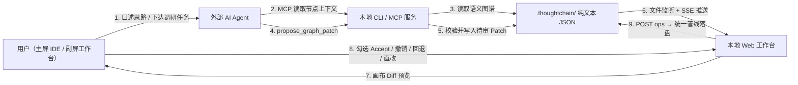
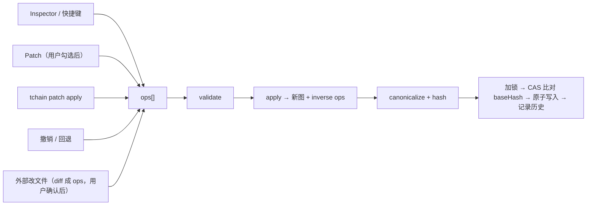
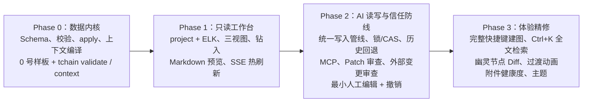

# 思维链决策工作台（ThoughtChain Workbench）产品需求文档（PRD）

> **文档状态**：v1.2（已合入技术审阅：统一变更管线、修订数据模型、投影规格、并发与安全、路线图重排）  
> **更新日期**：2026-11-25  
> **参考样板**：`新需求-思维链图.md`（业务仓库 `finance-news-flash/docs/feature/个股公告分析管道/全市场公告采集解析与多空分析/新需求-思维链图.md`）  
> **0 号样板图**：[fixtures/announcement-pipeline.tgraph.json](../fixtures/announcement-pipeline.tgraph.json)  
> **目标平台**：PC 桌面端浏览器（个人本机使用 + 现场投屏汇报）+ CLI / MCP 协议

### 修订记录

| 版本 | 主要变化 |
| :--- | :--- |
| v1.1 | 范围收敛：纯自动排版、单源三视图、不内置 LLM、三道信任防线 |
| v1.2 | 新增 `parked` 状态与容器状态汇总；`summary` 拆为 `description` / `conclusion`；删除 `order`、`rejected_branch`、边 `id`；新增唯一位置原则与环约束；所有写入统一为 ops 管线，Patch 增加 `baseHash` / `before` / `deps`；外部直接改文件纳入审查；规定 `project()` 投影流水线并修正焦点算法；补充锁 + CAS、本地服务安全；推送改为 SSE；路线图新增 Phase 0，Phase 1 只读 |

---

## 1. 一句话摘要（Executive Summary）

我们要构建一个**本地优先（Local-First）、AI 原生（AI-Native）的「思维链决策工作台」**。它以独立本地 Web 工作台 + CLI/MCP 服务的形态，运行在任意本地项目目录下。

- **替代 Markdown/Mermaid**：用**纯自动排版、可无限下钻的递归复合有向图**，把复杂工作中的思考路径、节点状态、决策依据和废弃/搁置方案持久化为“外置大脑”。
- **AI 安全协作**：所有写入都表达为**同一套原子操作（ops）**，并经过**三道信任防线**——Patch 审查、版本回退与撤销、人工直改。Codex、Antigravity 等外部 Agent 由此能读取精准上下文，并在受控条件下协作更新图谱。
- **汇报投屏**：一键切换至**汇报视图**，直接用于现场投屏，消除日常推进的认知负担和周报整理的内耗。

---

## 2. 问题背景与核心痛点（Problem Statement）

以实际业务文档 `新需求-思维链图.md` 为例，当前用「Markdown 笔记 + Mermaid 流程图 + 文末文件链接」记录工作思考。项目进入复杂调研与多轮决策后，暴露出四个结构性瓶颈：

| 痛点维度 | 现状表现 | 真实代价 |
| :--- | :--- | :--- |
| **层级复杂度失控** | 只能手动拆成“主分支图”和多个“子图”（如 `H2 小规模研究费用估算`）；同一个节点（如 `K 筛除公告类别`）在父图和子图中重复出现，且彼此割裂。 | 分支稍多即难以维护，失去全局视角。 |
| **工作记忆与状态缺失** | Mermaid 无法原生表达“正在做哪一步、哪些被搁置、下一步依赖什么”。废弃方案（如 `Tushare`、`全市场云解析`）既不敢删，留着又占视野；“暂停但可能恢复”的路线（如 `恢复新闻分析`）和“彻底否决”的方案混在一起。 | 每次都要重新回忆背景，容易遗漏前置约束或重复踩坑。 |
| **证据与节点割裂** | 8 篇调研文档平铺在文末 `## 参考文档`，无法挂到具体的决策或测算节点上，也无法标注“待补齐”或关键量化结论。 | 查阅和复核成本高，结论与依据脱节。 |
| **汇报内耗与 AI 割裂** | 每周要额外花数小时把琐碎过程重整为高层结论；新开 AI 会话时需要手动复制粘贴大量背景文档。 | 汇报准备耗时严重；AI 缺乏结构化的决策上下文。 |

---

## 3. 核心设计公理（Design Principles）

本产品服从以下 **5 条架构公理**，以保持系统极简、自洽、工程复杂度可控：

1. **纯语义驱动 + 100% 自动排版（不做手工拖拽定位）**  
   `*.tgraph.json` **只存储语义数据**（节点、父子归属、依赖边、状态、说明、结论、指标、证据路径），**完全不存坐标**。画面由 ELK.js 确定性地自动计算；布局结果只在内存里缓存，用于保持稳定，不持久化。
2. **单源多视图（Single Source of Truth）**  
   「全量工作态」「当前焦点态」「汇报态」，以及折叠、钻入、隐藏废弃项，都是同一个纯函数 `project(graph, viewState)` 的不同参数。**绝不维护两份图。**
3. **工具本身不调用 LLM（Deterministic Tool）**  
   不内置任何 LLM 调用，也不管理 API Key 或 Prompt。所有智能推理都交给用户本机的外部 Agent，通过 CLI / MCP 完成。
4. **一切写入皆为 ops（Single Mutation Pipeline）**  
   人工编辑、AI Patch、CLI 采纳、撤销/回退、外部改文件，统一归约为同一套原子操作。它们走同一条 `validate → apply → canonicalize → 加锁 CAS 落盘 → 留存历史` 管线。校验、历史、撤销、Diff 只实现一次。
5. **AI 协作三道信任防线（Human-in-the-Loop）**  
   - **事前把关（Patch 审查）**：AI 只能提交基于明确版本（`baseHash`）的变更提案。用户在画布上预览 Diff，逐条勾选后才落盘。绕过 MCP 直接改文件的行为同样会被拦截进审查。
   - **事后兜底（历史版本 + 撤销）**：每次落盘可撤销（Ctrl+Z）；关键节点自动留存快照，可一键回退，回退本身也可逆。
   - **即时修正（人工直改）**：界面可以直接增删改节点和边，发现小偏差随手修正。

---

## 4. 目标用户与四大核心工作流（User Flows）

- **主用户**：单人深度思考者（研发/研究/产品/项目负责人）。习惯副屏常驻浏览思维链，在终端/IDE 内与 AI Agent 协作，并定期向领导现场投屏汇报。
- **协作角色**：外部 AI Coding / Research Agent（Codex、Antigravity 等），通过 CLI / MCP 获取图谱上下文并提交变更提案。



### 四大核心场景闭环

- **场景 A · 日常推进（外置大脑）**：打开副屏进入「焦点态」，3 秒内看清当前在做的节点、它是经过哪些关键决策走到这里的、下一步可以做什么；点击节点，在右侧抽屉阅读挂载的 Markdown 报告。
- **场景 B · 口述生长（零摩擦建图）**：用户直接向 Agent 口述一段思考流水账（如原文档的 `## 口述`）。Agent 调用 MCP 提交 Graph Patch，副屏实时弹出变更预览，用户审查后点 Accept，新分支自动排版长出来。（Phase 1 先由 Agent 直接编辑 JSON，工作台热刷新；Phase 2 起走 Patch 审查。）
- **场景 C · AI 委派与安全回写**：针对某个调研节点（如 `K3 核对结构化财报覆盖范围`），Agent 通过 `get_node_context` 拿到裁剪后的上下文包，完成调研并写好报告，然后提交 Patch：把节点标为 `done`、填入 `conclusion`、挂载报告路径。应用后不满意，可以撤销、回退或手动微调。
- **场景 D · 现场投屏汇报**：切到「汇报态」，隐藏执行细节，大屏只展示核心路线与量化数字。领导追问细节时，**双击复合容器直接下钻**，展示子图与证据文档。

---

## 5. 核心数据模型与文件规范（Domain Model）

### 5.1 本地存储目录规范

在任意项目根目录（或用户指定目录）下初始化 `.thoughtchain/`。所有文件都是 Git 友好的 UTF-8 JSON：

```text
<workspace>/
└── .thoughtchain/
    ├── tgraph.schema.json                           # tchain init 生成的 JSON Schema（供 IDE / Agent 补全与校验）
    ├── graphs/
    │   └── announcement-pipeline.tgraph.json        # 唯一语义真源（入库）
    ├── patches/
    │   ├── 20261125-1430-codex-cost-est.patch.json  # 待审 Patch
    │   └── archive/                                 # 已采纳/已驳回 Patch（滚动保留，可 .gitignore）
    ├── history/
    │   └── announcement-pipeline/
    │       ├── index.json                           # 历史版本索引（rev、时间、来源、变更计数）
    │       ├── rev-0001.json                        # 快照（可 .gitignore）
    │       └── rev-0002.json
    ├── ui-state.json                                # 展开/折叠容器、上次视图等 UI 状态（可 .gitignore）
    └── .lock                                        # 写锁（运行时文件，必须 .gitignore）
```

> 注：不存任何坐标或布局文件。图谱文件的 `$schema` 字段指向 `../tgraph.schema.json`，便于在 Phase 1 由 Agent 或人直接编辑 JSON 时获得补全和即时校验。

### 5.2 节点语义类型（`type`）

| 类型值 | 中文语义 | 典型例子（源自样板文档） | 汇报态默认可见 |
| :--- | :--- | :--- | :--- |
| `goal` | 业务目标 / 起点锚点 | 持续采集全市场公告并回补历史一年 | 是 |
| `decision` | 关键决策点 / 拍板分岔 | 是否购买 Gangtise？公告分析是否值得投数万元？ | 是 |
| `option` | 候选方案 / 探索分支 | 购买 Gangtise / 自主本地建设 / 小规模研究 | 是 |
| `task` | 具体调研 / 测算 / 执行步骤 | 抽样统计个股近一年公告数、硬件吞吐调研 | 否（可用 `report: true` 覆盖） |
| `milestone` | 阶段结论 / 汇合点 | 形成方案对比结论、汇总降本后研究预算 | 是 |

### 5.3 节点生命周期状态（`status`）

| 状态值 | 中文语义 | 视觉与行为约定 | 快捷键 |
| :--- | :--- | :--- | :--- |
| `todo` | ⏳ 待推进 | 中性态；处于“就绪前沿”时在焦点态高亮 | `1` |
| `active` | 🔥 进行中（当前焦点） | 强高亮边框 / 指示灯；焦点态的核心锚点 | `2` |
| `blocked` | 🚧 阻塞 / 待拍板 | 琥珀色警示，`statusNote` 写明阻塞原因 | `3` |
| `done` | ✅ 已完成 / 已采纳 | 绿色徽章，柔和沉稳 | `4` |
| `parked` | ⏸️ 已搁置（可恢复） | 蓝灰色暂停徽标，**不加删除线**；`statusNote` 写明搁置原因与恢复条件。可整体收起为“已搁置 n 项”胶囊 | `5` |
| `discarded` | 🗄️ 已否决（不再考虑） | 灰阶虚线 + 删除线；可折叠为“已排除 n 项”墓碑胶囊；**强制鼓励**在 `statusNote` 中写明否决原因 | `6` |

> `parked` 与 `discarded` 的区别：`parked` 表示“现在不做、条件满足可恢复”（如“暂停公告分析，恢复新闻分析”“领导暂缓全市场方案”）；`discarded` 表示“调研后否决，避免再踩坑”（如“Tushare 公告 PDF 接口”）。上下文编译器会把两者分别输出为「可恢复路线」和「避坑约束」。

#### 5.3.1 容器状态汇总与有效状态

- **容器默认不填 `status`，由子节点汇总**（按以下优先级取第一个命中项）：
  1. 任一子节点为 `active` → `active`
  2. 任一子节点为 `blocked` → `blocked`
  3. 任一子节点为 `todo` → `todo`
  4. 子节点全部为终态（`done` / `parked` / `discarded`）：有 `done` → `done`；否则有 `parked` → `parked`；否则 → `discarded`
- **显式覆盖**：容器显式填写 `status` 时以显式值为准。典型用法是整体搁置（`parked`）或整体否决（`discarded`）一个方案容器。
- **有效状态（effectiveStatus）**：如果某个祖先容器被**显式**标为 `parked` / `discarded`，其后代中处于**非终态**（`todo` / `active` / `blocked`）的节点，在焦点计算、上下文编译和视觉降噪中按最近的这类祖先的状态处理；`done` / `discarded` 节点保留自身状态（已完成的调研结论和已否决的避坑记录不因容器搁置而改变含义）。后代自身的 `status` 字段不变，恢复容器后自动生效。例：样板中 `D1` 自身是 `blocked`，所在容器 `D 自主本地建设` 被搁置，因此 `D1` 的有效状态为 `parked`；而 `D2`（done）和 `X1`（discarded）保持原状态。

### 5.4 层级包含与依赖关系

- **层级包含（`parentId`）**：每个节点至多一个 `parentId`（顶层节点省略该字段），全部 `parentId` 构成严格无环树，支持无限嵌套。拥有子节点的节点自动渲染为**复合容器**。
- **唯一位置原则**：一个节点只出现在图中的一个位置。需要在两个上下文中都出现的，用跨容器边连接，而不是复制节点。
- **同级顺序 = `nodes` 数组中的相对顺序**：不设 `order` 字段。布局引擎按模型顺序排列同层节点；插入新节点时用 `add_node { after }` 指定位置。
- **逻辑连线（`edges[]`）**：边始终沿“推进方向”：`source` 是前置，`target` 是后续。共 3 种语义：
  - `flow`（默认，可省略）：实线，主推进流向；
  - `depends_on`：虚线，数据或条件前置依赖（target 需要 source 的产出或结论）；
  - `revises`：反馈 / 修正回流（如“降本测算回流修正预算基线”），渲染为回流弧线。
- **指向否决/搁置节点的边**不需要专门的边类型：target 的有效状态为 `discarded` 时自动渲染为灰色虚线，为 `parked` 时渲染为蓝灰色虚线。
- **结构约束**：
  - 不允许自环和重复边，`(source, target)` 即边的主键；
  - **禁止在祖先与后代之间连边**（包含关系已经表达了这层语义）；
  - **去掉 `revises` 边后，剩余的 `flow` / `depends_on` 边必须构成 DAG**。`revises` 是唯一允许成环的边，所有图遍历算法都不沿它前进。
- **折叠态边界投影**：见 §6.1 投影流水线中的“边上提”。

### 5.5 内容与证据字段

| 字段 | 类型 | 说明 |
| :--- | :--- | :--- |
| `title` | string | 节点短标题（建议 ≤ 30 字） |
| `description` | string? | **做什么 / 为什么**：任务说明、判断口径（如“按抽样个股年均公告数推算”） |
| `conclusion` | string? | **得出了什么**：1~2 句结论，供折叠预览、汇报卡片和 AI 上下文压缩使用；`todo` 节点通常为空 |
| `statusNote` | string? | 状态备注，语义由 `status` 决定：`blocked` 时为阻塞原因，`parked` 时为搁置原因与恢复条件，`discarded` 时为否决原因 |
| `metrics[]` | `{ label, value, tone? }[]` | 结构化量化指标，`tone ∈ neutral / positive / warning` |
| `attachments[]` | `{ path? , url? , title?, note? }[]` | 证据挂载。`path` 与 `url` 必须且只能填一个；`path` 是**相对工作区根目录的 POSIX 路径**（`/` 分隔，存储解码后的原文，不存 `%20`）；附件类型由扩展名或 URL 推导 |
| `report` | boolean? | 覆盖汇报态的默认可见规则 |

### 5.6 Schema 定义（Zod 为唯一真源）

`core` 包中的 Zod Schema 是唯一定义。前端、服务端、MCP 入参、导出的 `tgraph.schema.json` 都由它生成，口径完全一致。

```ts
type Graph = {
  $schema?: string;
  schemaVersion: 1;                      // 整数；升级通过 migrations[n → n+1] 纯函数完成
  id: string;
  title: string;
  layout?: { direction?: "DOWN" | "RIGHT" };
  nodes: Node[];                         // 扁平数组；同级顺序 = 数组中的相对顺序
  edges: Edge[];
};

type Status = "todo" | "active" | "blocked" | "done" | "parked" | "discarded";

type Node = {
  id: string;                            // /^[A-Za-z][A-Za-z0-9_-]{0,39}$/，人类可读（A、H2、K3）
  parentId?: string;
  type: "goal" | "decision" | "option" | "task" | "milestone";
  title: string;
  status?: Status;                       // 叶子节点必填；容器省略时由子节点汇总
  statusNote?: string;
  description?: string;
  conclusion?: string;
  metrics?: { label: string; value: string; tone?: "neutral" | "positive" | "warning" }[];
  attachments?: { path?: string; url?: string; title?: string; note?: string }[];
  report?: boolean;
};

type Edge = {
  source: string;
  target: string;
  kind?: "flow" | "depends_on" | "revises";   // 省略即 flow；边 ID 由 `${source}->${target}` 推导
};
```

> 时间戳、作者等元数据不写入图谱文件（避免每次写入都改动同一行，导致 Git 冲突），由 `history/index.json` 记录。

### 5.7 校验规则（validate）

**错误（error，拒绝写入）：**

- Schema 与枚举不合法；id 格式不合法；节点 id 重复；
- `parentId` 指向不存在的节点，或形成环；
- 叶子节点缺少 `status`；
- 边端点不存在、自环、重复边、祖先-后代边；
- 去掉 `revises` 后存在环；
- 附件同时填写或同时缺失 `path` / `url`；附件 `path` 规范化后越出工作区根目录（含 `..` 与绝对路径）。

**警告（warning，允许写入并在 UI 中提示）：**

- `discarded` / `blocked` / `parked` 缺少 `statusNote`；
- 附件路径指向的文件不存在；
- 容器显式填写的 `status` 与汇总结果冲突（如容器写 `done`，但仍有子节点 `active`）；
- 同一图中存在多个 `goal` 顶层节点（允许，仅提示）。

**错误格式**统一为结构化对象，便于 Agent 自行修正：

```json
{
  "level": "error",
  "opIndex": 3,
  "path": "ops[3].node.parentId",
  "code": "PARENT_CYCLE",
  "message": "parentId 形成环：K3 → K → K3",
  "hint": "请将 K 的 parentId 改为 H 或省略"
}
```

### 5.8 规范化序列化（canonicalize）

所有写入都先规范化再落盘，保证 Git diff 只涉及局部：

- 两空格缩进，UTF-8，LF 换行，文件末尾保留换行；
- 顶层字段顺序固定：`$schema, schemaVersion, id, title, layout, nodes, edges`；
- 节点字段顺序固定：`id, parentId, type, title, status, statusNote, description, conclusion, metrics, attachments, report`；边字段顺序固定：`source, target, kind`；
- `nodes` 保持模型顺序（即同级顺序）；`edges` 按 `nodes` 中 source 的位置、再按 target 的位置排序；
- 省略空数组、空字符串和默认值（如 `kind: "flow"`）；
- 附件路径统一为 `/` 分隔。

### 5.9 0 号样板映射

样板 `新需求-思维链图.md` 的主图、费用估算子图、废弃项和全部参考文档，已经按本规范手工映射为 [announcement-pipeline.tgraph.json](../fixtures/announcement-pipeline.tgraph.json)。层级结构如下：

```text
A   持续采集全市场公告并回补历史一年（goal，parked）
B   方案评估：是否购买 Gangtise？（decision 容器，汇总为 done）
├── C   购买 Gangtise 服务（option 容器，显式 parked）── C1、C2
├── D   自主本地建设（option 容器，显式 parked）── D1、X1(discarded)、D2、X2(discarded)、D3
└── E   形成方案对比结论（milestone）
F   领导决定搁置两套全市场方案（milestone）
G   公告分析是否值得投入数万元？（decision 容器）
├── H   小规模研究公告分析的价值（option 容器）
│   ├── H1  爬虫采集 + 云服务解析
│   ├── H2  费用估算（容器，report）
│   │   ├── H3 DeepSeek 费用 / H4 云解析费用（容器：H6 → H7 → H8）/ H5 代理池费用
│   │   └── H9 全量处理基线（milestone）
│   ├── K   研究可筛除或替代的公告类别（容器，report）── K1 → … → K6
│   ├── M   自建公告分类体系
│   ├── N   公告分析结果测评与优化
│   ├── L   公告事件与行情相关性研究
│   └── H10 是否值得继续投入（decision）
└── I   暂停公告分析，恢复新闻分析（option，parked）

跨容器边：A→B、E→F、F→G、H7→K1、H8→H9、H9→K5、K→L、H2→N(depends_on)
回流边：K6 -revises-> H9
```

要点：

- **原文中 `K` 节点重复出现的问题，用唯一位置原则解决**：`K` 只作为 `H` 的子容器存在。`H2` 和 `K` 都折叠时，`H7→K1` 自动上提为 `H2→K`，等价于原主图中的 `H2 --> K`。
- **原子图里的 `H2 --> H3/H4/H5` 这类“容器指向自己子节点”的边**，已经由 `parentId` 表达，不再画成边。
- **D1 的有效状态**：D1 自身为 `blocked`（分页完整性与持续运行稳定性待验证；已有 12,000 份 PDF 采集实测），由于所在容器 `D` 被显式搁置，有效状态为 `parked`。
- **预算与当前焦点**：`H8`（解析费用）和 `H9`（三项费用基线）已有初版预算，均为 `done`；结论保留目标板块名单、服务实测等待验证条件。`K1` 保持 `active`：已有类别数量统计，但按类别统计 PDF 页数和文本长度尚未完成。
- **口述补充映射**：`M`（自建公告分类体系）来自原文口述第 3 项；`N`（公告分析结果测评与优化）来自小规模研究路线中的并行任务说明。共补充 2 个节点和 1 条边；`H2 → N`（`depends_on`）表达费用估算前置，仍需满足费用可接受并开始采集的条件。

样板片段：

```json
{
  "id": "K2",
  "parentId": "K",
  "type": "task",
  "title": "优先评估财报原件",
  "status": "todo",
  "description": "财报原件约占公告总数 7%，每份平均约 10 万字符，优先评估能否用已有结构化财报数据替代",
  "metrics": [
    { "label": "数量占比", "value": "~7%", "tone": "neutral" },
    { "label": "单份长度", "value": "~10万字符", "tone": "warning" }
  ]
}
```

---

## 6. 视图、投影与交互规范（Views & Projection）

桌面端主界面由三个区域组成：

- **顶部控制栏**：图谱选择器、层级面包屑、视图切换器、已废弃/已搁置显隐开关、版本历史、待审 Patch 徽章、搜索；
- **中央画布**：React Flow 渲染，节点位置锁定，只能平移和缩放；布局由 ELK.js 自动计算；
- **右侧 Inspector 抽屉**：节点详情、指标、结论、证据预览；Phase 2 起提供编辑表单。

### 6.1 投影流水线 `project(graph, viewState) → RenderGraph`

所有视图与交互状态都通过同一条纯函数流水线生成，这是整个前端测试密度最高的模块：

```text
Graph
 → derive         派生：索引、祖先表、容器汇总状态、有效状态
 → visibility     可见性谓词：workspace / focus / report + 已废弃、已搁置的显隐开关
 → ancestorClose  可见节点的所有祖先容器强制可见，避免子节点悬空
 → scope          钻入根节点（只保留其子树）；折叠集合（折叠容器的子树收起）
 → edgeLift       端点被折叠收起：上提到最近的可见祖先容器
 → edgeBypass     端点被隐藏（如汇报态的 task）：从可见节点出发，只经过隐藏节点做 BFS，
                  连到可见的上下游，标注“经过 n 个隐藏步骤”
 → externalStubs  钻入后指向视野外的边：在边框处生成“外部节点桩”，点击跳转
 → dedupe         合并平行边，显示计数角标；上提后的自环直接丢弃
 → RenderGraph    交给 ELK 布局
```

- `viewState = { view, drillRoot, collapsed, showDiscarded, showParked, focusOverride? }`；
- 同一份 RenderGraph（按哈希判断）直接命中布局缓存。

### 6.2 视图一：全量工作态（Workspace View）

- **递归复合节点**：
  - 容器右上角提供「展开 / 折叠」，原地查看局部细节；
  - **双击容器钻入（Drill-down）**：以该容器为当前根节点，顶部显示面包屑（如 `根图谱 > 小规模研究 > 费用估算`）。按 `Esc` 或点击面包屑返回上层。视野外的连线显示为外部节点桩。
- **废弃 / 搁置分支收起**：两个开关独立控制。收起后在分叉处保留灰阶胶囊（如 `已排除 2 项`、`已搁置 1 项`），悬浮即可速览各项的标题与 `statusNote`。
- **全局导航**：`Ctrl/Cmd + K` 打开命令面板，模糊搜索任意层级的节点并一键定位或钻入；`F` 自适应画布（Fit View）。

### 6.3 视图二：当前焦点态（Focus View）

**焦点计算算法**（只沿 `flow` / `depends_on` 遍历，使用 visited 集合；有效状态为 `parked` / `discarded` 的节点一律跳过）：

1. **活跃集合 `S_active`**：有效状态为 `active` 的**叶子节点**。容器的 `active` 是汇总值，不计入。
2. **来路集合 `S_path`**：
   - `S_active` 中每个节点的**全部祖先容器**（包含链）；
   - 每个节点的**直接前驱**（距离为 1）；
   - 沿上游继续回溯时**只保留 `decision` / `milestone` / `goal`** 类型的节点，表示“经过了哪些拍板才走到这里”，不把汇合型图中的所有上游都纳入。
3. **下一步集合 `S_next`**：“就绪前沿”，即有效状态为 `todo` / `blocked`、且所有前驱都已是 `done` 或 `active` 的节点。只取 `S_active` 所在最近容器范围内的节点，避免全图泛化。
4. `S_focus = S_active ∪ S_path ∪ S_next`。
5. **空状态退化**：没有 `active` 节点时，显示全图的就绪前沿 + 所有 `blocked` 节点，并提示“当前没有进行中的节点”。

**视觉降噪**：`S_focus` 全彩显示；其他节点透明度降到 20%，也可以一键完全隐藏。完全隐藏时，经过隐藏节点的连线按 §6.1 的 `edgeBypass` 处理。

### 6.4 视图三：汇报态（Executive View）

- **一键净化界面**：隐藏编辑入口和草稿提示，放大字号、提高对比度，使用适合投屏的宽松布局参数。汇报态有**独立的布局缓存**，因为字号不同，节点尺寸也不同。
- **投影规则**：
  - 可见节点 = 按类型默认可见、或 `report: true` 的节点，以及它们的祖先容器（`ancestorClose`）；`report: false` 强制隐藏；
  - 隐藏的 `task` 用 `edgeBypass` 穿透连线，主线保持连通；
  - 容器默认折叠，卡片突出显示 **`conclusion`** 与 **`metrics` 徽章**；已否决、已搁置的分支默认收起为胶囊。
- **现场即时下钻**：领导追问某个数字时，双击对应容器下钻，展示完整推导子图；点击文档徽章，右侧滑出 Markdown 证据预览；按 `Esc` 平滑退回主干视图。

### 6.5 右侧 Inspector 抽屉

- **详情区**：标题、类型、状态（含有效状态提示，如“继承自 D：已搁置”）、`statusNote`、`description`、`conclusion`、上下游连线列表。Phase 2 起这一区域可编辑。
- **指标区**：`metrics` 卡片，与画布卡片同步显示。
- **证据区**：
  - 列出 `attachments`，点击本地 Markdown 即在抽屉扩展面板中渲染预览，支持表格、列表、代码高亮，Mermaid 懒加载后静态渲染；
  - 预览中的相对链接和图片通过服务端文件接口解析，文档之间的链接可以在面板内直接跳转；
  - 「在 IDE 中打开」通过 `vscode://file/<abs>` 等 URL scheme 实现，服务端不启动外部进程；
  - **健康度检测**（Phase 3）：路径失效显示红色提示；附件标题含“待补齐”或文档 frontmatter 含 `status: draft` 时显示橙色角标。**不扫描正文中的 `TODO`**，误报太多。

### 6.6 编辑交互（Phase 2 起提供）

所有编辑都生成 ops，并经 `POST /api/graphs/:id/ops` 提交到统一管线。

- **快捷键**（只在画布获得焦点、且不在输入框内时生效）：
  - `Tab`：在选中节点内新建子节点（自动升级为容器）；
  - `Enter`：新建同级兄弟节点，插在选中节点之后；
  - `Ctrl + Enter`：新建下游节点并自动连 `flow` 边；
  - `1 ~ 6`：切换状态（`todo / active / blocked / done / parked / discarded`），切到 `blocked` / `parked` / `discarded` 时自动聚焦 `statusNote` 输入框；
  - `Delete`：删除选中的节点或边（`Backspace` 不用于删除）；
  - `Ctrl + Z / Ctrl + Shift + Z`：撤销 / 重做。
- **连线**：节点不可拖动，但**可以从节点 handle 拖出连线**到目标节点（纯语义操作）；点击边可修改类型，或按 `Delete` 删除。
- **结构调整**：在 Inspector 中修改 `parentId`（移动层级）和同级位置（上移 / 下移，对应 `after`）。删除容器时选择“仅拆散”（子节点按原顺序插回容器原来的位置）或“级联删除”，两种操作都可撤销并自动生成快照。
- **MVP 编辑子集**（Phase 2）：状态切换、编辑文字字段、删除、handle 建边、撤销/重做。完整快捷键建图放在 Phase 3。

---

## 7. 人机共生协议与三道信任防线（AI-Native Protocol & Safety）

### 7.1 统一变更管线



`core` 包只包含纯函数，前端、CLI、MCP 共用：

| 函数 | 职责 |
| :--- | :--- |
| `validate(graph, ops?)` | 结构化错误与警告（§5.7） |
| `apply(graph, ops)` | 返回 `{ graph, inverse }`，按顺序执行；任一操作非法则整体失败 |
| `diff(a, b)` | 两份图之间的最小 ops（用于外部变更审查与历史对比） |
| `canonicalize(graph)` / `hash(graph)` | 规范化序列化与 `sha256` |
| `project(graph, viewState)` | 投影流水线（§6.1） |
| `focus(graph)` | 焦点集合（§6.3） |
| `compileContext(graph, nodeId, opts)` | 上下文编译器（§7.5） |

### 7.2 原子操作集合（5 种）

| 操作 | 参数 | 说明 |
| :--- | :--- | :--- |
| `add_node` | `{ node, after? }` | `after` 为同级兄弟节点 id；省略时追加到同级末尾。新 id 由提交方提供，与已有 id 冲突即报错 |
| `update_node` | `{ id, set, unset? }` | `set` 可包含除 `id` 外的任意字段，含 `parentId`（移动层级）、`status`、`attachments`；`set.after` 用于调整同级位置 |
| `remove_node` | `{ id, cascade }` | `cascade: false` 时拆散容器，子节点就地上移；与被删节点相连的边一并删除 |
| `add_edge` | `{ source, target, kind? }` | 如果同一主键的边已存在，则覆盖其 `kind` |
| `remove_edge` | `{ source, target }` | — |

- 同一批操作**按顺序执行**，后面的操作可以引用前面新增的节点；
- “废弃时缺少 `statusNote`”“附件不存在”这类检查属于校验器的 lint 警告，不需要单独的操作类型。

### 7.3 Patch 文件格式

```json
{
  "id": "20261125-1430-codex-cost-est",
  "graphId": "announcement-pipeline",
  "baseHash": "sha256:…",
  "author": "codex",
  "title": "K3 调研完成并回写结论",
  "rationale": "已核对结构化财报覆盖范围……",
  "state": "pending",
  "ops": [
    {
      "op": "update_node",
      "id": "K3",
      "set": { "status": "done", "conclusion": "…" },
      "before": { "status": "todo" }
    },
    {
      "op": "add_node",
      "node": { "id": "K7", "parentId": "K", "type": "task", "title": "…", "status": "todo" },
      "after": "K6"
    },
    { "op": "add_edge", "source": "K7", "target": "H10", "deps": [1] }
  ],
  "diagnostics": []
}
```

- **`baseHash`**：propose 时由服务端写入，表示这份 Patch 基于哪个版本的图；
- **`before`**：propose 时由服务端写入，Agent 不需要提供。它有两个用途：Diff 预览直接显示前后对比；apply 时如果当前图的哈希已不等于 `baseHash`，逐个操作比对 `before`，冲突的操作标红并默认取消勾选，不冲突的照常应用（轻量 rebase）；
- **`deps`**：由校验器推导的操作依赖。用户取消勾选某个 `add_node` 时，UI 自动连带取消引用它的边和子节点；勾选某个操作时，自动勾选它依赖的操作；
- **apply 时重新完整校验**，因为 propose 时的校验结果可能已经过期；
- **状态流转**：`pending → applied | partially_applied | rejected`。处理后的 Patch 移到 `patches/archive/`，保留最近 100 份。

### 7.4 CLI 命令规范

所有面向终端的 JSON 输出都使用缩进多行 JSON（`indent=2`），便于人工审阅：

| 命令 | 用途 | 阶段 |
| :--- | :--- | :--- |
| `tchain init [dir]` | 初始化 `.thoughtchain/`，生成 `tgraph.schema.json` 和 `.gitignore` 片段 | P0 |
| `tchain validate [graph]` | 校验图谱，输出结构化错误与警告；失败时退出码非 0 | P0 |
| `tchain context <graph> [--node <id>] [--format md\|json] [--max-tokens N]` | 上下文编译器 | P0 |
| `tchain fmt [graph]` | 按规范化规则重写图谱文件 | P0 |
| `tchain serve [dir] [--port 4377]` | 幂等启动/复用该工作区 Web 工作台 + 文件监听 + SSE + HTTP MCP；新服务端口被占用时自动递增 | P1/P2 |
| `tchain list` | 列出所有图谱与状态摘要（进行中/待办/阻塞/搁置节点数） | P1 |
| `tchain mcp [dir]` | 兼容模式：启动客户端私有的 stdio MCP 子进程；日常共享使用 `serve` 的 `/mcp` URL | P2 |
| `tchain patch propose <graph> --file <patch.json>` | 校验并提交变更提案 | P2 |
| `tchain patch list` / `show <id>` / `apply <id> [--only 0,2]` / `reject <id>` | 查看、（部分）采纳或驳回 Patch | P2 |
| `tchain history <graph>` / `tchain rollback <graph> <rev>` | 查看历史版本 / 回退 | P2 |

### 7.5 MCP Server 工具清单

共享部署使用 `tchain serve` 同进程提供的 `/mcp`（Streamable HTTP，无状态 JSON 响应）。每个服务固定绑定一个工作区；多个 Codex/Cursor 客户端配置同一 URL，各请求隔离协议状态，共享文件存储及现有写锁/CAS/Patch 审查管线。HTTP MCP 复用 Web 服务的 token、Host/Origin 与跨站请求校验。无独立 SSE 流或会话，GET/DELETE 返回 405。

`serve` 以真实工作区路径识别实例，启动锁串行化并发启动；复用前验证存活 PID、鉴权健康接口、工作区、随机实例 ID 与 MCP URL。PID 已不存在时恢复，PID 存活但校验失败时拒绝重复启动。token 持久保存在 `.thoughtchain/.server-token`，实例信息保存在 `server.json`；两者及启动锁均忽略版本控制。stdio 保留为兼容入口，不对其应用“工作区单进程”锁，因为独立 stdio 客户端需要独立通信管道。

工具入参 Schema 直接复用 `core` 中的 Zod 定义；工具描述中明确写出“**修改图谱请调用 `propose_graph_patch`，不要直接编辑 `.tgraph.json`**”。

#### 只读工具（Context Discovery）

1. `list_graphs()`：所有图谱的元数据、当前哈希与焦点节点列表。
2. `get_graph_overview(graphId, maxDepth?)`：顶层结构、关键决策、进行中分支、已搁置路线概览。
3. `get_node_context(graphId, nodeId, format = "md", maxTokens?)`：**上下文编译器**。默认输出 Markdown，比 JSON 更省 token，固定包含 6 段：
   - ① **全局目标**：所属的 `goal` 节点及其当前状态；
   - ② **决策来路**：包含链 + 上游 `decision` / `milestone` 节点及其 `conclusion`；
   - ③ **避坑约束**：同级及上游有效状态为 `discarded` 的方案及其否决原因；
   - ④ **可恢复路线**：同级及上游有效状态为 `parked` 的路线及其搁置原因和恢复条件；
   - ⑤ **当前任务与邻接节点**：节点详情、指标、前置依赖、直接下游；
   - ⑥ **关联证据路径**：相关节点挂载的文件相对路径，方便 Agent 直接读取。

   超出 `maxTokens` 时，按 ⑥ → ④ → ② 的顺序裁剪远端内容。
4. `search_nodes(graphId, query, status?)`：按关键词或状态检索节点。

#### 写入提案工具（Patch-Only Mutation）

5. `propose_graph_patch(graphId, title, rationale, ops[])`：
   - 操作集合见 §7.2；
   - 服务端立即执行完整校验（§5.7）。不合法时返回结构化错误，Agent 可以据此自行修正；合法时写入 `patches/`，并返回 `patchId` 与警告列表；
   - **不提供任何直接写图的 MCP 工具**。

### 7.6 三道信任防线

#### 防线一：Diff 审查（事前把关）

1. Agent 调用 `propose_graph_patch`，写入 `.thoughtchain/patches/<id>.patch.json`；
2. `tchain serve` 的文件监听器在 **500ms 内**通过 SSE 通知浏览器；
3. 画布顶部弹出提示条：`收到 AI 变更提案「…」（+4 节点 / 2 状态变更 / +1 文档挂载）[审查变更]`；
4. 点击「审查变更」进入 **Diff 预览**：
   - **Phase 2**：右侧显示变更清单（按操作分组，冲突项标红），画布在“应用勾选项后的图”上高亮：新增节点绿色虚线框，修改节点琥珀色光晕并悬浮显示前后对比，状态变更显示 `todo → done`；
   - **Phase 3**：幽灵节点布局。对 base 图与新图的并集做布局，被删节点以红色删除线保留在原位，移动节点显示双位置；
5. 逐条勾选（依赖关系自动联动）后点击「应用」落盘，或点击「驳回」归档。

**外部直接改文件同样进入审查**：服务端保存最后一次已知的规范化内容与哈希。监听到外部修改（Agent 直接编辑、`git pull` / `checkout`、IDE 保存）后：

- 内容不合法：画布顶部显示红色横幅并列出具体错误，**画布保持上一份合法版本**，不覆盖用户文件；
- 内容合法：计算 `diff(last, new)` 得到 ops，以「外部变更」的形式进入与 Patch 相同的审查界面。用户可以接受（只更新基线，不重写文件），也可以一键还原。
- **Phase 1 例外**：Phase 1 还没有审查界面，外部合法修改直接热刷新；不合法时显示红色横幅。

#### 防线二：撤销 + 历史版本（事后兜底）

- **撤销 / 重做**：每次落盘记录 inverse ops，形成会话内的撤销栈；撤销本身也是一次提交 inverse ops 的写入。
- **自动快照**：以下时机在覆写前留存快照：
  - Accept 一份 Patch 或外部变更；
  - 级联删除节点；
  - 回退之前；
  - **人工编辑闲置 2 分钟**时，把这段编辑合并为一个“人工编辑会话”快照；
  - 手动点击「保存还原点」。
- **快照格式**：`rev-NNNN.json` 保存完整图；`index.json` 记录 `{ rev, at, source, title, counts, hash }`。默认保留最近 50 份，滚动清理。
- **一键回退**：顶栏「版本历史」面板列出历次变更摘要，可与当前版本对比（`diff`）并回退。回退前先留存当前版本，因此回退本身也可逆。`.tgraph.json` 是规范化纯文本，项目的 Git 历史天然构成第二层永久备份。

#### 防线三：人工直改（即时修正）

Accept 之后发现标题不准、边连错方向、层级放偏，不需要让 AI 重来，直接在 Inspector 或画布上修改即可。修改即时落盘、自动重排，并且可以撤销。

---

## 8. 技术架构与非功能需求（Technical Architecture）

### 8.1 技术栈（单语言 TypeScript）

| 模块 | 选型 | 理由 |
| :--- | :--- | :--- |
| 前端框架 | React + TypeScript + Vite | 生态成熟，适合交互密集型工作台 |
| 画布 | `@xyflow/react`（React Flow） | 只使用平移缩放、自定义节点、选中与键盘、handle 连线、minimap；`nodesDraggable={false}`；**不使用其 `parentId` 子流程**，所有节点拍平为绝对坐标，容器作为低 zIndex 的背景节点渲染 |
| 自动布局 | `elkjs`（ELK Layered），运行在 **Web Worker** 中 | 原生支持复合图与跨层连线；放进 Worker 避免阻塞主线程 |
| 前端状态 | Zustand | 服务端是唯一真源，前端只缓存 Graph、投影结果和 UI 状态；撤销走 inverse ops |
| 命令面板 / 搜索 | `cmdk` + `minisearch` | 轻量成熟；附件全文索引放在服务端（Phase 3） |
| Markdown | `react-markdown` + `remark-gfm` + `rehype-highlight`；Mermaid 动态 import | 首屏体积可控；不启用 `rehype-raw`；Mermaid 使用 `securityLevel: "strict"` |
| 本地 HTTP | Hono + `@hono/node-server` | 体积小，自带 `streamSSE` |
| 实时推送 | **SSE**（`EventSource`） | 推送是单向的，写入走 HTTP POST；浏览器原生支持断线重连，无需额外依赖 |
| 文件监听 | chokidar v4（开启 `awaitWriteFinish`） | 跨平台；IDE 保存时的连续事件合并为一次 |
| 原子写 / 锁 | `write-file-atomic` + `proper-lockfile` | 处理 Windows 下 rename 的 `EPERM` / `EBUSY`，以及多进程写入互斥 |
| CLI | `commander`（或 `citty`） | — |
| MCP | `@modelcontextprotocol/sdk`（stdio） | 入参复用 `core` 的 Zod Schema（实施前确认 SDK 支持的 Zod 主版本） |
| Schema | Zod v4 + `z.toJSONSchema()` 导出 | 一份定义，生成运行时校验、TS 类型和 JSON Schema |
| 测试 | Vitest + fast-check + Playwright（桌面视口） | 见 §8.6 |
| 打包分发 | pnpm workspace 开发，tsup 打包成**单个 npm 包**（内含前端 dist） | 用户只需 `npm i -g` 或 `npx` 安装 |

### 8.2 仓库结构

```text
tchain/
├── packages/
│   ├── core/      # 纯函数、零 IO：schema、validate、apply、diff、canonicalize、project、focus、compileContext
│   ├── server/    # 单一可执行入口：CLI（commander）+ HTTP/SSE（Hono）+ MCP（stdio）+ 存储层（锁/CAS/历史）
│   └── web/       # React 工作台；ELK Worker
└── fixtures/
    └── announcement-pipeline.tgraph.json   # 0 号样板，同时作为 project / focus / context 的快照测试输入
```

### 8.3 布局引擎落地要点

- **跨层级边**：`elk.hierarchyHandling: INCLUDE_CHILDREN`。每条边声明在 source 与 target 的**最近公共容器（LCA）**内；ELK 返回的边路由坐标是**相对 LCA 的**，渲染前必须换算为绝对坐标。
- **稳定性**：
  - `elk.layered.considerModelOrder.strategy: NODES_AND_EDGES`；
  - `elk.layered.crossingMinimization.forceNodeModelOrder: true`；
  - 固定 `elk.randomSeed`；
  - 内存中缓存上一次的坐标，作为增量布局提示（只缓存，不持久化）。
- **回流边**：`revises` 边在布局输入中被标记为反馈边（`elk.layered.cycleBreaking.strategy: MODEL_ORDER`），渲染为回流弧线。
- **节点尺寸**：ELK 需要事先知道宽高。每种节点类型、每种视图使用**固定卡片宽度**，用 canvas `measureText` 估算标题、结论换行和指标行的高度；必要时退回两遍渲染（先隐藏渲染测量，再布局）。
- **边渲染**：自定义 edge 组件，按 ELK 返回的折点绘制圆角折线。不使用 React Flow 自带的 bezier / smoothstep，避免连线穿过其他容器。
- **缓存**：以 `hash(RenderGraph) + view` 为键缓存布局结果。
- **过渡动画**（Phase 3）：节点用 CSS transform 做 200ms 过渡；过渡期间边淡出，结束后再淡入。不做折线路径插值。

### 8.4 持久化与并发

- **单一写入入口**：前端不直接写文件，统一 `POST /api/graphs/:id/ops { baseHash, ops }`；CLI 的 `apply` / `rollback` 走同一个存储层。`tchain mcp` 的 propose 只新建 `patches/` 下的文件，不写图文件。
- **写入步骤**：
  1. 获取 `.thoughtchain/.lock`（带过期回收）；
  2. 读取当前文件并计算哈希，与请求中的 `baseHash` 比对，不一致则返回 `409 STALE_BASE`；
  3. 在内存中执行 `validate → apply → canonicalize`；
  4. 写入历史快照（如果满足触发条件）；
  5. `write-file-atomic` 写临时文件后 rename（Windows 下带重试）；
  6. 记录“最后写入的哈希”，watcher 据此过滤自身写入引起的事件；
  7. 释放锁并通过 SSE 广播 `{ graphId, hash }`。
- **路径**：附件统一存储为 POSIX `/`；比较路径时，Windows 下不区分大小写；导入 Markdown 链接时对 `%20` 等做 URL 解码。

### 8.5 本地服务安全

只监听 localhost 并不足够：浏览器中的任意网页都能向 `127.0.0.1` 发请求（CSRF），也可以借助 DNS rebinding 读取响应。而本服务恰好能读取工作区文件。因此：

- 只绑定 `127.0.0.1`；
- `tchain serve` 启动时生成随机 token，打印带 token 的访问 URL；首次访问后写入 `HttpOnly; SameSite=Strict` cookie；
- 所有 HTTP / SSE 请求校验 `Host`（必须是 `127.0.0.1:<port>` 或 `localhost:<port>`）和 `Origin`；
- 文件读取接口：`realpath` 后必须仍在工作区根目录内（防止 symlink 逃逸）；拒绝 `.env*`、`.git/` 以及 `.thoughtchain/.lock`；只允许白名单内的扩展名。

### 8.6 非功能性指标

- **布局性能**：单图 200 个节点、嵌套深度 5 层以内，Worker 中完成 ELK 重排 < 300ms；命中缓存的视图切换 < 50ms。
- **实时响应**：Patch 写入或外部修改后，浏览器在 500ms 内收到通知并刷新。
- **数据安全**：所有写入走 §8.4 流程，不会出现半写入的文件，也不会静默覆盖他人的修改。
- **正确性测试**：
  - `apply` 的 property-based 测试：随机 ops 序列不会产生非法图；`apply(apply(g, ops).inverse) == g`；
  - `canonicalize` 幂等；
  - `project` / `focus` / `compileContext` 以 0 号样板做快照测试。
- **桌面视口**：只面向 PC 桌面浏览器（1280×720 及以上），重点优化 1920×1080 投屏与副屏常驻。

---

## 9. 明确不做什么（Out of Scope）

1. **不做手工拖拽排版**：节点位置完全由 ELK.js 计算；坐标只在内存中缓存。
2. **不做演进回放（Timeline / Story Replay）**：只保留面向数据安全的历史版本、对比与回退。
3. **不内置 LLM 调用**：不提供模型配置页，不托管 API Key，不内置聊天框。
4. **不做多人协同与云端服务**：不开发账号、权限、云端数据库、多人实时编辑。
5. **不做单文件 HTML / PPT 导出**：聚焦本机现场投屏。
6. **不做移动端与平板适配**。

---

## 10. 分阶段路线图与验收标准（Roadmap & Acceptance Criteria）



### Phase 0：数据内核（预计数天）

- **交付范围**：
  - `core` 包：Zod Schema、`validate`、`apply`（含 inverse）、`diff`、`canonicalize`、`focus`、`compileContext`；导出 `tgraph.schema.json`；
  - CLI：`tchain init`、`tchain validate`、`tchain fmt`、`tchain context`；
  - 0 号样板 `announcement-pipeline.tgraph.json` 通过校验，并纳入测试 fixture。
- **核心验收标准**：
  - [ ] 0 号样板无歧义地覆盖原文档的全部节点、子图、废弃项、搁置项和参考文档，`tchain validate` 零错误；
  - [ ] `tchain context announcement-pipeline --node K3` 的输出能让一个新开的 Agent 会话准确复述：目标、走到 K3 经过了哪些决策、哪些方案已否决及原因、哪些路线已搁置；
  - [ ] 故意构造非法图（`parentId` 环、祖先-后代边、非 `revises` 环、越界路径），`tchain validate` 返回带 `code` / `path` / `hint` 的错误；
  - [ ] `apply` 的 property-based 测试与 `canonicalize` 幂等测试通过。

### Phase 1：只读工作台 + 现场汇报可用

- **交付范围**：
  - `tchain serve`（Hono + SSE + chokidar + token 鉴权 + 文件读取边界）、`tchain list`；
  - `project()` 投影流水线全部步骤；React Flow 绝对坐标渲染 + ELK Worker + 自定义折线边；
  - 原地展开/折叠、双击钻入、面包屑、外部节点桩、已否决/已搁置胶囊；
  - 「全量工作态」「焦点态」「汇报态（含现场下钻）」三视图切换；
  - Inspector 只读详情 + Markdown 证据预览；
  - **修改方式**：由 Agent 或人直接编辑 JSON（有 `$schema` 补全，`tchain validate` 兜底）；合法修改热刷新，不合法时显示红色横幅并保留上一份合法版本。
- **核心验收标准**：
  - [ ] 打开 0 号样板，双击 `H2 费用估算` 能无卡顿地下钻到完整的费用估算子图；折叠 `H2` 与 `K` 后，显示上提的 `H2 → K` 边，跨层依赖不丢失；
  - [ ] 焦点态准确高亮当前推进路径（以 `K1` 为进行中锚点，并保留已完成预算 `H8` / `H9` 的相关决策来路），已否决和已搁置的分支被降噪；
  - [ ] 汇报态隐藏 `task` 后主线仍然连通（`edgeBypass`），可全屏投屏，并能现场下钻、打开 `gangtise收费方案.md` 等本地文档预览；
  - [ ] Agent 直接修改 JSON 后，画布在 500ms 内自动重排；写入非法 JSON 时画布不崩溃并给出错误提示；
  - [ ] 从其他网页（不同 Origin）请求服务接口被拒绝。

### Phase 2：AI 读写闭环 + 信任防线

- **交付范围**：
  - 存储层：锁 + CAS + 原子写 + 历史快照 / 索引；`POST /ops` 统一写入入口；
  - `tchain mcp`（5 个工具）、`tchain patch *`、`tchain history` / `tchain rollback`；
  - Patch 审查界面：变更清单、依赖联动勾选、冲突标红、在应用后的图上高亮；
  - 外部变更审查（diff 成 ops，接受或还原）；
  - 最小人工编辑：状态切换、编辑文字字段、删除、handle 建边、撤销/重做；版本历史面板（对比 + 回退）；
  - 界面一键「复制当前节点 AI 上下文」。
- **核心验收标准**：
  - [ ] 在 Codex / Antigravity 中配置 MCP 后，Agent 能通过 `get_node_context` 准确复述某个节点的决策来路、避坑约束与可恢复路线；
  - [ ] 向 Agent 口述一段新的决策变化，Agent 提交 Patch 后，副屏 1 秒内亮起提示；只勾选部分操作时依赖自动联动，应用后画布自动重排并落盘；
  - [ ] 提交 Patch 后先在 UI 手工修改同一节点，再采纳该 Patch：冲突操作被标红并默认取消勾选，人工修改不会被静默覆盖；
  - [ ] Agent 绕过 MCP 直接改 JSON，变更以「外部变更」形式进入审查，并可一键还原；
  - [ ] 采纳后可以 Ctrl+Z 撤销，也可以在版本历史中回退到采纳前；回退操作本身可以再回退；
  - [ ] 构造非法 Patch（`parentId` 环、悬空边、id 冲突），MCP 拦截并返回结构化错误。

### Phase 3：体验精修

- 完整快捷键建图（`Tab` / `Enter` / `Ctrl+Enter`）与 Inspector 完整编辑；
- `Ctrl/Cmd + K` 跨层级节点 + 证据全文检索；
- 幽灵节点 Diff 布局；重排过渡动画；
- 附件健康度角标（路径失效 / 待补齐）；
- 深浅色主题（暗色用于副屏常驻，亮色用于会议室投屏）。

---

## 11. 风险评估与待拍板事项（Risks & Open Questions）

### 关键技术风险与缓解策略

1. **增删节点后自动排版导致位置跳动**  
   - *风险*：新增一个节点后，同级节点可能互换位置，破坏用户的空间记忆。  
   - *缓解*：同级顺序 = 模型顺序，配合 ELK 的 `considerModelOrder` + `forceNodeModelOrder` 和固定随机种子；内存中缓存上次坐标作为增量提示；Phase 3 再加节点过渡动画。
2. **深层嵌套下跨层级连线缠绕**  
   - *风险*：超过 3 层嵌套且存在多条跨层依赖时，同时展开多个容器会显得拥挤。  
   - *缓解*：以双击钻入为主要阅读方式，钻入后用外部节点桩代替长连线；提供“跨层级边仅在选中关联节点时高亮”的开关；`dedupe` 合并平行边。
3. **ELK 跨层边坐标换算与节点尺寸估算**  
   - *风险*：LCA 相对坐标换算出错会导致连线错位；尺寸估算不准会导致文字溢出。  
   - *缓解*：Phase 1 首周用 0 号样板做布局冒烟测试，包含所有跨容器边类型；固定卡片宽度，加入尺寸估算的单元测试。
4. **外部 Agent 不遵守 Patch 协议**  
   - *缓解*：外部直接改文件也进入审查（§7.6），防线不依赖 Agent 自觉遵守。

### 下一步待拍板事项

- **工具命名与仓库位置**：建议作为独立新仓库开发，便于全局安装 CLI、在任意项目目录使用。需确定最终项目名与 CLI 命令缩写（如 `tc` / `tchain`）。——独立新仓库开发，项目命名`tchain`
- **0 号样板核对**：请确认 [announcement-pipeline.tgraph.json](../fixtures/announcement-pipeline.tgraph.json) 中其余节点的**当前状态**是否与实际进度一致；本轮已按证据校正 `H8` / `H9` 为初版预算完成、`K1` 为进行中，并更新 `D1` 的阻塞原因。Phase 0 的验收依赖这份样板。——已核验。
